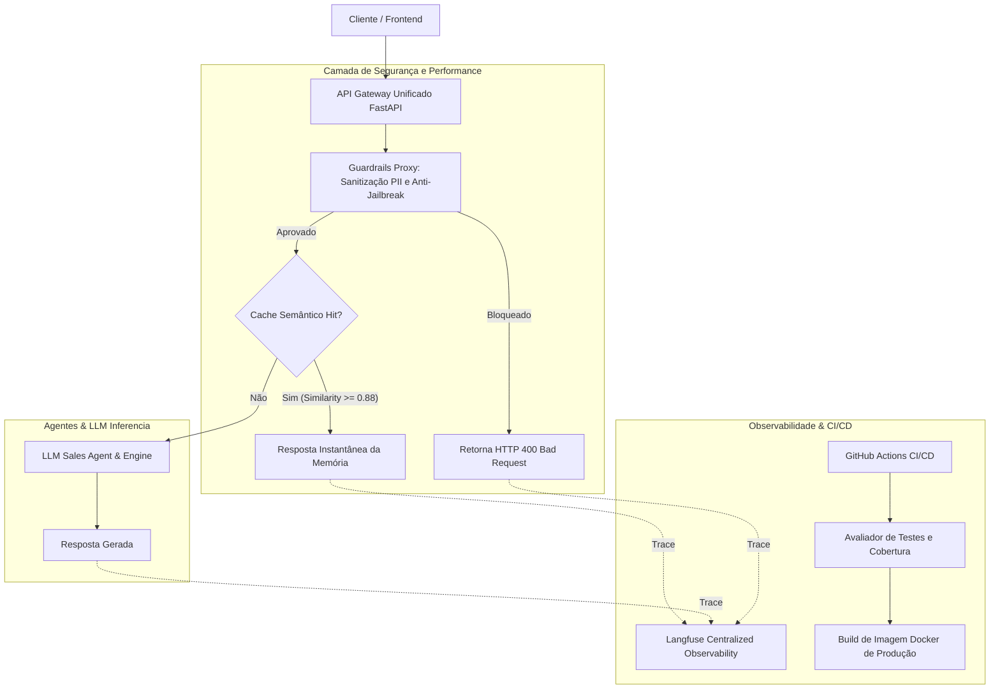

# LLMOps Industrial Unified Pipeline 🚀🏭


> **O Ápice da Engenharia de LLMs**: Arquitetura Unificada de Referência Industrial integrando API Gateway, Cache Semântico, Guardrails de Segurança (PII & Prompt Injection), Agentes Inteligentes, CI/CD com Quality Gates e Observabilidade Centralizada no Langfuse.

---

## 🧭 Visão Geral da Arquitetura

O **`llm-llmops`** unifica todas as fases anteriores do portfólio em um único ecossistema pronto para produção:



---

## ⚡ Módulos Integrados

| Módulo | Função |
| :--- | :--- |
| **API Gateway Unificado** | Orquestra a pipeline de requisição ponta a ponta com rotas REST e documentação OpenAPI. |
| **Guardrails Proxy** | Inspeciona ataques de Prompt Injection e higieniza automaticamente dados sensíveis (CPFs/Emails). |
| **Semantic Cache** | Evita chamadas custosas à LLM retornando respostas pré-computadas para dúvidas frequentes. |
| **Langfuse Observability** | Grava o ciclo de vida completo da requisição, métricas de latência e sinalizações de segurança. |
| **GitHub Actions CI/CD** | Executa o Quality Gate automatizado a cada `push` / `pull_request`. |

---

## 🚀 Como Executar

### 1. Execução via Docker Compose
```bash
docker-compose up --build
```
Acesse o endpoint de saúde:
```bash
curl http://localhost:8000/health
```

### 2. Execução dos Testes Integrados
```bash
docker run --rm -e PYTHONPATH=/app -v $(pwd):/app -w /app python:3.12-slim bash -c "pip install pytest pytest-cov fastapi uvicorn pydantic pydantic-settings langfuse httpx && pytest --cov=app --cov-report=term-missing"
```

---

## 🛡️ Licença & Autor
Desenvolvido por **Cayo Neves** ([@cayoesn](https://github.com/cayoesn)) como o projeto final e consolidado do Portfólio de LLM & LLMOps de Alta Performance.