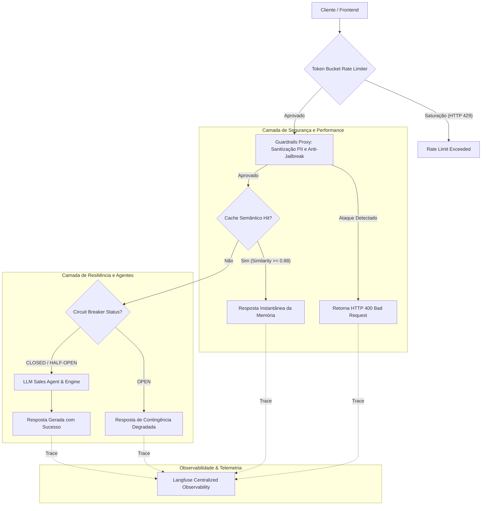

# LLMOps Industrial Unified Pipeline 🚀🏭


> **Arquitetura Unificada de Referência Industrial**: API Gateway resiliente integrando **Token Bucket Rate Limiting**, **Circuit Breaker Tri-State**, Cache Semântico, Guardrails de Segurança (PII & Prompt Injection), Agentes Inteligentes e Observabilidade Langfuse.

---

## 🧭 Visão Geral da Arquitetura



---

## ⚡ Módulos & Padrões Staff

| Módulo | Padrão / Algoritmo | Complexidade | Garantia Operacional |
| :--- | :--- | :--- | :--- |
| **Rate Limiter** | Token Bucket contínuo fracionário | $\mathcal{O}(1)$ | Prevenção de DoS e saturação por tenant |
| **Circuit Breaker** | Tri-State (`CLOSED`, `OPEN`, `HALF_OPEN`) | $\mathcal{O}(1)$ | Fallback gracioso contra colapso de upstream LLM |
| **Guardrails Proxy** | Regex Unificada + Detecção de Jailbreak | $\mathcal{O}(\|T\|)$ | Sanitização atômica de PII e bloqueio de injeção |
| **Semantic Cache** | Cache vetorial em memória | $\mathcal{O}(1)$ / sub-5ms | Economia de custo e baixa latência |
| **Langfuse Obs** | Rastreamento distribuído de traces/spans | Assíncrono | Visibilidade total de ciclo de vida e erros |

---

## 🚀 Como Executar no Docker

```bash
docker-compose up -d --build
```

Endpoints de acesso:
- **API Gateway**: `http://localhost:8000` (OpenAPI interativa em `/docs`)
- **Healthcheck & Circuit Status**: `http://localhost:8000/health`
- **Painel de Observabilidade (Langfuse)**: `http://localhost:3008`

---

## 🧪 Testes Automatizados (100% Hermético)

```bash
docker run --rm -v $(pwd):/workspace -w /workspace -e PYTHONPATH=/workspace portfolio-spec-engine:test pytest tests -v
```
